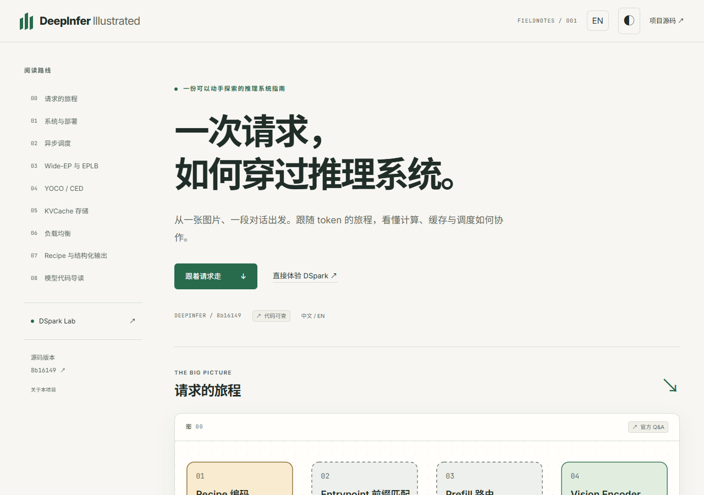
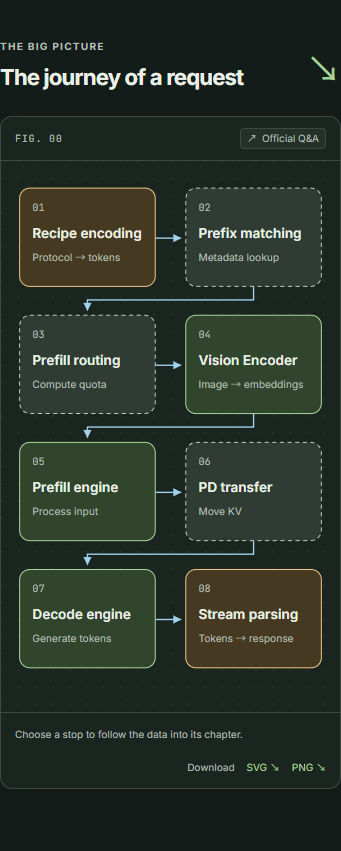

# DeepInfer Illustrated — 执行与核验报告

完成日期：2026-10-20（Asia/Shanghai）。锁定上游：`8b16149741a4935e1dec8cea27853f273b374c5b`。

## 交付结果

完整实现中英双语网站：8个章节、总览旅程、9张手绘SVG图、DSpark/SWA/异步调度3个交互演示，以及深浅主题、移动布局、键盘操作和减少动态效果支持。

- 代码仓库：https://github.com/elarazju/deepinfer-illustrated
- 目标线上地址：https://elarazju.github.io/deepinfer-illustrated/ （部署验证中）
- 事实库：35条，其中32条 confirmed、3条 inferred；每项保留锁定提交代码链接或官方Q&A/报告来源。
- 导出：9图 × 中英 × 深浅 × SVG/PNG，共72个文件，位于 `public/figures/`。
- 内容协议CC BY 4.0，网站代码MIT。页脚明确标注非官方项目。

## 阶段任务

- [x] 阶段1：阅读锁定源代码、官方Q&A，建立并核验双语事实库。
- [x] 阶段2：双语骨架、总览、主题与移动布局。
- [x] 阶段3：8章正文、9张静态图与事实检查。
- [x] 阶段4：三个交互演示与模型边界测试。
- [x] 阶段5：模型代码与官方V4.1技术报告对照。
- [x] 阶段6：SVG/PNG导出、SEO、分享图和无障碍修正。
- [x] 阶段7：未参与制作的独立agent审核；详见文末。
- [ ] 发布验收：GitHub Actions成功及线上页面、资源验证。

## 验证与证据

- `npm run build`：Svelte/TypeScript零错误零警告，事实检查35条通过。
- `npm test`：5项算法测试通过，包括DSpark零/全置信度、k=0选择和累积概率、SWA短输入与对齐边界、时间线CPU瓶颈。
- `scripts/check-length.ts`：C1–C7中文960–1277字符、英文825–897词，详见 [字数结果](research/content-lengths.json)。C8按代码导读呈现。
- Chrome/WebKit × 中英 × 深浅 × 1280/375宽度，16组合通过；无页面横向溢出或脚本错误，交互边界、键盘与减少动态效果通过。见 [浏览器结果](research/browser-results.json)。
- axe在中英/深浅4组合的WCAG 2 A/AA、2.1 AA规则检查中零违规；22组文字语义色对比度全部≥4.5，最小4.71。见 [自动无障碍结果](research/accessibility-results.json)、[对比度结果](research/contrast-results.json)。自动检查仍有需要人工判断的项目，不构成完整WCAG认证。
- 80张截图覆盖首页、总览与8章的双语/双主题/双宽度；独立审核检查全部截图，见下表。
- 官方模型报告的章节页码、代码对照见 [模型来源记录](research/MODEL-SOURCES.md)。

## 来源口径与限制

- Q&A描述生产系统，README描述开源配置与能力；未发布的缓存和负载均衡服务使用虚线并明确标注。
- SWA回放窗口128、代码命中余量134、README compact示例保留140分别列项，不互相替换，也不推断差值的设计原因。
- `flops_estimator.hpp` 是FLOPs记账器，不作为未开源二次时间代价模型的实现证据。
- DSpark为单请求教学模型；实际实现跨请求分配预算。可调置信度、耗时、时间线空闲比例均明确标注示意，与官方测量结果分开。
- 模型章只解释可核查代码和官方描述，设计动机不足之处不补写推测；推断项显著标注。
- 未运行DeepInfer模型或声称复现SM100/Ascend性能数据。WebKit测试不是Safari真机验收。375宽度下部分静态图允许图内横向滚动。
- 原始PDF与提取文本仅供本地核对，不随网站发布。
- 依据用户指定使用elarazju发布。此前创建的minghaochen同名仓库为空，未推送项目内容。

## 截图

每格含桌面1280和手机375宽度截图。章节截图隐藏固定顶栏以完整呈现图文，首页截图保留实际导航。

| 页面 | 中文浅色 | 中文深色 | English light | English dark |
| --- | --- | --- | --- | --- |
| 首页 | [1280](research/screenshots/zh-light-1280-home.png) / [375](research/screenshots/zh-light-375-home.png) | [1280](research/screenshots/zh-dark-1280-home.png) / [375](research/screenshots/zh-dark-375-home.png) | [1280](research/screenshots/en-light-1280-home.png) / [375](research/screenshots/en-light-375-home.png) | [1280](research/screenshots/en-dark-1280-home.png) / [375](research/screenshots/en-dark-375-home.png) |
| 总览 | [1280](research/screenshots/zh-light-1280-journey.png) / [375](research/screenshots/zh-light-375-journey.png) | [1280](research/screenshots/zh-dark-1280-journey.png) / [375](research/screenshots/zh-dark-375-journey.png) | [1280](research/screenshots/en-light-1280-journey.png) / [375](research/screenshots/en-light-375-journey.png) | [1280](research/screenshots/en-dark-1280-journey.png) / [375](research/screenshots/en-dark-375-journey.png) |
| C1 系统 | [1280](research/screenshots/zh-light-1280-system.png) / [375](research/screenshots/zh-light-375-system.png) | [1280](research/screenshots/zh-dark-1280-system.png) / [375](research/screenshots/zh-dark-375-system.png) | [1280](research/screenshots/en-light-1280-system.png) / [375](research/screenshots/en-light-375-system.png) | [1280](research/screenshots/en-dark-1280-system.png) / [375](research/screenshots/en-dark-375-system.png) |
| C2 异步调度 | [1280](research/screenshots/zh-light-1280-scheduling.png) / [375](research/screenshots/zh-light-375-scheduling.png) | [1280](research/screenshots/zh-dark-1280-scheduling.png) / [375](research/screenshots/zh-dark-375-scheduling.png) | [1280](research/screenshots/en-light-1280-scheduling.png) / [375](research/screenshots/en-light-375-scheduling.png) | [1280](research/screenshots/en-dark-1280-scheduling.png) / [375](research/screenshots/en-dark-375-scheduling.png) |
| C3 专家 | [1280](research/screenshots/zh-light-1280-experts.png) / [375](research/screenshots/zh-light-375-experts.png) | [1280](research/screenshots/zh-dark-1280-experts.png) / [375](research/screenshots/zh-dark-375-experts.png) | [1280](research/screenshots/en-light-1280-experts.png) / [375](research/screenshots/en-light-375-experts.png) | [1280](research/screenshots/en-dark-1280-experts.png) / [375](research/screenshots/en-dark-375-experts.png) |
| C4 YOCO | [1280](research/screenshots/zh-light-1280-yoco.png) / [375](research/screenshots/zh-light-375-yoco.png) | [1280](research/screenshots/zh-dark-1280-yoco.png) / [375](research/screenshots/zh-dark-375-yoco.png) | [1280](research/screenshots/en-light-1280-yoco.png) / [375](research/screenshots/en-light-375-yoco.png) | [1280](research/screenshots/en-dark-1280-yoco.png) / [375](research/screenshots/en-dark-375-yoco.png) |
| C5 存储 | [1280](research/screenshots/zh-light-1280-storage.png) / [375](research/screenshots/zh-light-375-storage.png) | [1280](research/screenshots/zh-dark-1280-storage.png) / [375](research/screenshots/zh-dark-375-storage.png) | [1280](research/screenshots/en-light-1280-storage.png) / [375](research/screenshots/en-light-375-storage.png) | [1280](research/screenshots/en-dark-1280-storage.png) / [375](research/screenshots/en-dark-375-storage.png) |
| C6 路由 | [1280](research/screenshots/zh-light-1280-routing.png) / [375](research/screenshots/zh-light-375-routing.png) | [1280](research/screenshots/zh-dark-1280-routing.png) / [375](research/screenshots/zh-dark-375-routing.png) | [1280](research/screenshots/en-light-1280-routing.png) / [375](research/screenshots/en-light-375-routing.png) | [1280](research/screenshots/en-dark-1280-routing.png) / [375](research/screenshots/en-dark-375-routing.png) |
| C7 配方 | [1280](research/screenshots/zh-light-1280-recipe.png) / [375](research/screenshots/zh-light-375-recipe.png) | [1280](research/screenshots/zh-dark-1280-recipe.png) / [375](research/screenshots/zh-dark-375-recipe.png) | [1280](research/screenshots/en-light-1280-recipe.png) / [375](research/screenshots/en-light-375-recipe.png) | [1280](research/screenshots/en-dark-1280-recipe.png) / [375](research/screenshots/en-dark-375-recipe.png) |
| C8 模型 | [1280](research/screenshots/zh-light-1280-model.png) / [375](research/screenshots/zh-light-375-model.png) | [1280](research/screenshots/zh-dark-1280-model.png) / [375](research/screenshots/zh-dark-375-model.png) | [1280](research/screenshots/en-light-1280-model.png) / [375](research/screenshots/en-light-375-model.png) | [1280](research/screenshots/en-dark-1280-model.png) / [375](research/screenshots/en-dark-375-model.png) |

## 独立审核

由未参与制作的独立 agent 完成。详细逐条核验、初轮问题与修复轨迹见 [独立审核记录](research/INDEPENDENT-AUDIT.md)。

- 全部35条事实完成独立来源审查：32条 confirmed、3条 inferred。README 锚点及PDF页码覆盖问题已修正；新增 YOCO 等价检查与原文一致。官方模型技术报告 §2.2–2.4.4 与本文对照未发现科学性矛盾。
- C1–C7 事实正文加可展开讲解：中文960–1277字符、英文825–897词，均达到计划下限。C8 保持明确标记的代码导读。
- 独立运行事实检查通过；原有代码链接全部 HTTP 200，锚点在锁定提交内。检查时上游默认分支 HEAD 仍与锁定提交一致。
- 独立运行 Chrome/WebKit × 中英 × 深浅 × 1280/375 的16组合：无页面横向溢出和pageerror，展开阅读、键盘演示边界、减少动态效果检查通过；图像下载覆盖72个SVG/PNG文件。结果见 [独立浏览器记录](research/independent-browser-results.json)。
- 通过10张对照拼图检查全部80张截图，并对问题位置查看原图。首次截图中的顶栏遮挡、时间线文字拥挤、移动总览站名贴边和C1文字穿线均已修复；C6/C7必画说明已补齐。C8的GPU语义配色已修源码，需同步最后一轮该章导出与截图。
- 限制：WebKit测试不是Safari真机验收；自动无障碍检查不能替代完整人工与辅助技术评估；375宽度下非总览静态图在图内横向滚动。线上发布状态尚未由独立审核者验证。
